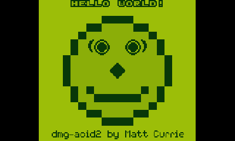

# GBabe

A Game Boy / Game Boy Color emulator for the **Nintendo 3DS**, built around
[Walnut-CGB](https://github.com/Mr-PauI/Walnut-CGB) — a single-header,
performance-oriented CGB emulator core.

Target: **Old 3DS / 2DS first.** No DSP firmware dump, no GPU shaders, no
dynamic recompilation, no external libraries beyond libctru.

<p align="center"></p>

*(the image above is the `dmg-acid2` test ROM rendered through GBabe's actual
render path by `tools/host`, not a mock-up)*

---

## Status

| Area | State |
|---|---|
| DMG (original Game Boy) emulation | core provided by Walnut-CGB |
| CGB (Game Boy Color) emulation | core provided by Walnut-CGB |
| Video (RGB565, line-by-line blit, 3 scale modes) | done |
| Audio (minigb_apu → CSND, buffered) | done |
| ROM browser, in-game menu, config file | done |
| `.sav` cartridge RAM (auto-save every 30 s) | done |
| Optional boot ROM | done |
| Save states | **not yet** |
| Link cable, cheat codes, SGB borders | not planned |

The 3DS target has not been through a CI build yet (see
[docs/PORT-NOTES.md](docs/PORT-NOTES.md)); the platform-independent parts are
compiled and run on the host by `tools/host`, which renders the screenshot
above.

---

## Build

You need [devkitPro](https://devkitpro.org/wiki/Getting_Started) with the
`3ds-dev` package group (devkitARM + libctru).

```sh
export DEVKITPRO=/opt/devkitpro
export DEVKITARM=$DEVKITPRO/devkitARM
export PATH=$DEVKITPRO/tools/bin:$DEVKITARM/bin:$PATH

make -j4
```

That produces `gbabe.3dsx` (and `gbabe.smdh`). Copy `gbabe.3dsx` to
`sdmc:/3ds/gbabe.3dsx` and launch it from the Homebrew Launcher — or build a
`.cia` from the same sources with `makerom` / `bannertool` if you prefer.

### Expectations on hardware

Written for the Old 3DS: one interpreter, no dynarec, no GPU. DMG titles are
the comfortable case; most CGB titles should hold full speed with the default
"fit height" scaler, and the menu has a frame-skip toggle for the ones that
don't. If a CGB game runs short on an Old 3DS, that is a core-speed limit, not
a rendering one — the blit is a straight 160-pixel-per-line copy.

---

## SD card layout

```
sdmc:/3ds/gbabe.3dsx          the app
sdmc:/3ds/gbabe/config.cfg    settings (created on first run)
sdmc:/3ds/gbabe/saves/        reserved for saved states
sdmc:/3ds/gbabe/bootrom/
    dmg_boot.bin              optional, not included
    cgb_boot.bin              optional, not included
```

ROMs can live anywhere; the browser starts at `sdmc:/` and remembers the last
folder. Save files are written **next to the ROM** as `<romname>.sav`, so they
work with other emulators too.

No ROMs or boot ROMs are included. Supply your own dumps.

---

## Controls

In game:

| 3DS | Game Boy |
|---|---|
| A / B | A / B |
| Start / Select | Start / Select |
| D-Pad or Circle Pad | D-Pad |
| X | toggle fast-forward (2x) |
| Y | next colour palette (DMG games) |
| Touch the bottom screen | open the menu |
| L + R | open the menu (alternative) |

In the menu: D-Pad to move, L/R or Left/Right to change a value, A to select,
B to resume. The menu has palette, scaling, frame skip, sound, status line,
reset, "load another ROM" and "quit".

---

## Settings

`config.cfg` is plain text, so a bad value can be fixed with any editor:

```ini
scale=0        ; 0 = fit height, 1 = stretch 400x240, 2 = original 160x144
palette=0      ; 0 = auto (per game), see source/palette.c for the table
frameskip=0    ; 0 = off, 1 = present every other frame
audio=1
hud=0          ; 1 = status lines on the bottom screen while playing
rom=sdmc:/roms/game.gbc
```

---

## How it fits together

```
source/main.c     services, input mapping, 59.7275 Hz frame pacing
source/emu.c      Walnut-CGB glue: ROM/save RAM callbacks, save files, boot ROM
source/video.c    RGB565 scanline blit into the rotated 3DS framebuffer
source/audio.c    minigb_apu -> software FIFO -> CSND blocks
source/palette.c  DMG palettes, including Game Boy Color "auto" colouring
source/ui.c       ROM browser, in-game menu, status readout
source/config.c   key=value settings on the SD card
third_party/      Walnut-CGB (MIT) and minigb_apu (MIT), vendored unmodified
tools/host/       PC harness: builds and runs the front-end without a 3DS
```

Design notes, the reasoning behind the CSND choice, and the measurements taken
while validating the port are in [docs/PORT-NOTES.md](docs/PORT-NOTES.md).

### Host harness

```sh
make -C tools/host            # builds ./gbabe-host
make -C tools/host check      # type-checks main.c and ui.c too
./tools/host/gbabe-host game.gb 300 out.ppm 0
```

It substitutes `tools/host/3ds.h` for libctru (same prototypes, no behaviour),
runs the real `emu.c`/`video.c`/`palette.c` and dumps the top screen as a PPM —
handy for checking a rendering or palette change without a console.

---

## Credits and licences

* **[Walnut-CGB](https://github.com/Mr-PauI/Walnut-CGB)** by Mr-PauI, MIT —
  the emulator core, a reimplementation of and successor to
  [Peanut-GB](https://github.com/deltabeard/Peanut-GB) by Mahyar Koshkouei.
  Vendored unmodified in `third_party/walnut/`.
* **[minigb_apu](https://github.com/deltabeard/Peanut-GB)** by Alex Baines and
  Mahyar Koshkouei, MIT — the audio processing unit emulation.
  Vendored unmodified in `third_party/minigb_apu/`.
* Everything else in this repository is MIT licensed, see [LICENSE](LICENSE).

Neither upstream project endorses this port; bugs in the front-end are mine,
bugs in the emulation are theirs (and worth reporting upstream).
