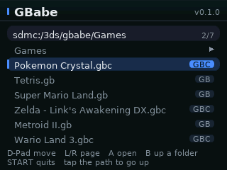
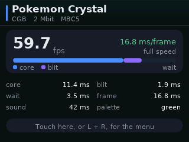

# GBabe

A Game Boy / Game Boy Color emulator for the **Nintendo 3DS**, built around
[Walnut-CGB](https://github.com/Mr-PauI/Walnut-CGB) — a single-header,
performance-oriented CGB emulator core.

Target: **Old 3DS / 2DS first.** No DSP firmware dump, no GPU shaders, no
dynamic recompilation, no external libraries beyond libctru.

<p align="center"></p>

<p align="center">


</p>

*(every image here is rendered by GBabe's own code, not a mock-up: the top one
is the `dmg-acid2` test ROM through the real render path in `tools/host`, the
two under it are the bottom screen through the real UI code in
`tools/uipreview`)*

---

## Status

| Area | State |
|---|---|
| DMG (original Game Boy) emulation | core provided by Walnut-CGB |
| CGB (Game Boy Color) emulation | core provided by Walnut-CGB |
| Video (RGB565, line-by-line blit, 3 scale modes) | done |
| Audio (minigb_apu → CSND, buffered) | done |
| ROM browser, in-game menu, config file | done |
| Bottom-screen UI: drawn (fonts, panels, animation), touch + buttons | done |
| `.sav` cartridge RAM (auto-save every 30 s) | done |
| Optional boot ROM | done |
| Save states | **not yet** |
| Link cable, cheat codes, SGB borders | not planned |

`.github/workflows/build.yml` builds `.3dsx` and `.cia` on GitHub's runners, on
every push and on demand. The platform-independent parts are compiled and run
on the host by `tools/host` (which renders the screenshot above) and
`tools/uipreview` (which renders the bottom screen). What none of that checks is
behaviour on real hardware — see [docs/PORT-NOTES.md](docs/PORT-NOTES.md).

---

## Build

You need [devkitPro](https://devkitpro.org/wiki/Getting_Started) with the
`3ds-dev` package group (devkitARM + libctru).

```sh
export DEVKITPRO=/opt/devkitpro
export DEVKITARM=$DEVKITPRO/devkitARM
export PATH=$DEVKITPRO/tools/bin:$DEVKITARM/bin:$PATH

make -j4
```

### The devcontainer (the toolchain CI uses)

`docker/gbabe-devcontainer.Dockerfile` is the whole build environment: a pinned
devkitARM plus makerom and bannertool, built from pinned sources. CI builds
inside it and so can you, which means the binary you get locally is the binary
CI produces:

```sh
bash docker/build-image.sh --pull      # ghcr.io/<owner>/gbabe-devcontainer:<hash>
docker run --rm -v "$PWD:/workspace" -w /workspace \
  "$(bash docker/build-image.sh)" bash docker/ci-build.sh
```

`docker/ci-build.sh` runs the whole pipeline — `.3dsx`, `.cia`, then the PC
harness, the dmg-acid2 render check and the UI previews — so one command tells
you whether a change is good. The image is tagged with a hash of its Dockerfile,
so changing the Dockerfile cannot silently reuse an old image.

VS Code / GitHub Codespaces: `.devcontainer/devcontainer.json` uses the same
Dockerfile, so "Reopen in container" gives you `make` and the packaging tools
ready to go.

That produces `gbabe.3dsx` (and `gbabe.smdh`). Copy `gbabe.3dsx` to
`sdmc:/3ds/gbabe.3dsx` and launch it from the Homebrew Launcher.

### Installable .cia

```sh
make cia
```

You need two extra tools that are **not** part of devkitPro:

* [makerom](https://github.com/3DSGuy/Project_CTR/releases) — builds the CIA
* [bannertool](https://github.com/carstene1ns/3ds-bannertool/releases) — builds
  the banner and the icon

Put both on `PATH`, or point the build at them:

```sh
make cia MAKEROM=/path/to/makerom BANNERTOOL=/path/to/bannertool
```

Prefer building them yourself over the prebuilt Linux archives: those are linked
against a newer glibc than many build images ship, and the only symptom is a
`GLIBC_2.3x not found` failure at the very end of the build. `.github/scripts/install-3ds-packaging-tools.sh`
does exactly that (a `make deps && make` for makerom, one `g++` line for
bannertool) at pinned tags.

The result is `gbabe.cia`, installed either by copying it to the SD card and
opening it with [FBI](https://github.com/Steveice10/FBI), or with GodMode9.
The CIA is unsigned, so it needs a console that will run unsigned titles (CFW);
target title id `0x000400000EABE100`, product code `CTR-H-GBABE`, unique ID
`0xEABE1` — change `APP_UNIQUE_ID` in the `Makefile` if it clashes with
something you already have installed.

`.cia`, `.3dsx` and `.smdh` are git-ignored; only sources and artwork live here.

### Building in CI (no devkitPro on your machine)

`.github/workflows/build.yml` can be started manually: **Actions → build → Run
workflow**, then pick:

| Input | Meaning |
|---|---|
| `target` | `both` (default), `3dsx`, or `cia` |
| `release_tag` | optional — upload the results to this GitHub release tag (created if missing) |

Finished files appear under the run's *Artifacts* (`gbabe-3dsx`, `gbabe-cia`).
Pushes to `main` and pull requests build both automatically, after the host
tests pass.

Because GitHub only reports workflow syntax errors *after* a push — and a broken
file means no job runs at all — the repository ships a checker:

```sh
python3 tools/lint-workflow.py            # YAML, expressions, step ids, bash -n
```

It catches the traps that bite here, such as a step output named `3dsx`, which
is not addressable as `steps.plan.outputs.3dsx` (GitHub's expression grammar
rejects property names starting with a digit) and has to be called something
like `want_3dsx`.

One more that only shows up on the runner: the container's glibc is older than
the one the published `makerom`/`bannertool` binaries are linked against (they
are built on Ubuntu 24.04, `devkitpro/devkitarm` is Debian), so those are
compiled from source instead of downloaded — otherwise the build dies at the
last step with `version `GLIBC_2.3x' not found`.
`.github/scripts/install-3ds-packaging-tools.sh` does that, at pinned tags; it
also works on a normal machine:

```sh
sudo bash .github/scripts/install-3ds-packaging-tools.sh
```

The 3DS job itself runs in the build image above (`docker run`), so nothing in
it depends on the runner's shell or libraries. If the published image is missing
or broken it builds the image; if that fails too it falls back to the stock
`devkitpro/devkitarm` image, and `docker/ci-build.sh` installs the packaging
tools itself.

### The bottom screen

The browser, the pause menu and the status readout are drawn by GBabe itself
into a 320x240 canvas (`source/ui_gfx.c` for the rasteriser, `ui_screens.c` for
the layouts, `ui_font.c` for the anti-aliased text) and pushed to the screen
with a single framebuffer write. libctru's text console is not used at all; see
[docs/PORT-NOTES.md](docs/PORT-NOTES.md) for why that mattered more than
anything else on an Old 3DS.

The browser opens in the folder of the last ROM you played, takes D-pad/Circle
Pad to move, `L`/`R` to jump a page — or just tap a ROM twice. `B` goes up a
folder (so does tapping the path bar), `START` quits. It only shows folders and
`.gb`/`.gbc`/`.sgb`/`.dmg` files, and it scans a folder when you enter it rather
than on every key press — on a card with a lot of files that difference is the
difference between instant and a second per tap.

### Expectations on hardware

Written for the Old 3DS: one interpreter, no dynarec, no GPU. DMG titles are
the comfortable case; most CGB titles should hold full speed with the default
"fit height" scaler, and the menu has a frame-skip toggle for the ones that
don't.

If a game *is* too slow, the bottom screen tells you why — it redraws a
per-frame breakdown once a second:

```
59.7 fps            16.8 ms/frame          <- fps, and the wall time per frame
core #########.....  blit  wait            <- how the 16.7 ms budget is spent
core 11.4   blit 1.9
wait  3.5   frame 16.8
```

* a large **core** figure is the interpreter: nothing else is competing for
  that time, so it needs a faster core (see below) or frame skip;
* a large **blit** figure means the scaled copy is the cost, which scale mode
  changes (the pixel-perfect 160x144 mode is the cheapest to fill);
* a large **wait** figure is normal — it is the time the console spends idle
  waiting for the next Game Boy frame.

Known speed levers, in order of effect:

| lever | effect |
|---|---|
| `-O3 -flto` (the default, `OPT=` in the `Makefile`) | ~45% faster emulation loop than `-O2` |
| X (turbo) | runs two emulated frames per presented one, at the cost of dropped frames |
| frame skip in the menu | halves the blit cost, keeps emulation speed |
| sound off in the menu | removes the APU mixing and the CSND hand-off |
| `WALNUT_GB_16_BIT_OPS` in `third_party/walnut/walnut_cgb.h` | a few percent, at the cost of accuracy in some games |

---

## SD card layout

```
sdmc:/3ds/gbabe.3dsx          the app
sdmc:/3ds/gbabe/config.cfg    settings (created on first run)
sdmc:/3ds/gbabe/saves/        reserved for saved states
sdmc:/3ds/gbabe/bootrom/
    dmg_boot.bin              optional, not included
    cgb_boot.bin              optional, not included
```

ROMs can live anywhere; the browser starts at `sdmc:/` and remembers the last
folder. Save files are written **next to the ROM** as `<romname>.sav`, so they
work with other emulators too.

No ROMs or boot ROMs are included. Supply your own dumps.

---

## Controls

In game:

| 3DS | Game Boy |
|---|---|
| A / B | A / B |
| Start / Select | Start / Select |
| D-Pad or Circle Pad | D-Pad |
| X | toggle fast-forward (2x) |
| Y | next colour palette (DMG games) |
| Touch the bottom screen | open the menu |
| L + R | open the menu (alternative) |

In the menu: D-Pad to move, Left/Right to change a value, A to select, B to
resume, and L/R (or a tap on the tab) to switch between the *Game* and
*Settings* tabs. The menu has palette, scaling, frame skip, sound, the status
readout, reset, "load another ROM" and "quit". Everything in it is also
reachable with the stylus: tap a row to select it, tap it again to activate it.

---

## Settings

`config.cfg` is plain text, so a bad value can be fixed with any editor:

```ini
scale=0        ; 0 = fit height, 1 = stretch 400x240, 2 = original 160x144
palette=0      ; 0 = auto (per game), see source/palette.c for the table
frameskip=0    ; 0 = off, 1 = present every other frame
audio=1
hud=0          ; 1 = status lines on the bottom screen while playing
rom=sdmc:/roms/game.gbc
```

---

## How it fits together

```
source/main.c     services, input mapping, 59.7275 Hz frame pacing
source/emu.c      Walnut-CGB glue: ROM/save RAM callbacks, save files, boot ROM
source/video.c    RGB565 scanline blit into the rotated 3DS framebuffer
source/audio.c    minigb_apu -> software FIFO -> CSND blocks
source/palette.c  DMG palettes, including Game Boy Color "auto" colouring
source/ui.c       ROM browser, in-game menu, status readout (state + input)
source/ui_screens.c  what every screen looks like
source/ui_gfx.c   software rasteriser + the framebuffer write
source/ui_font.c  generated 4-bit glyph atlases (tools/make-font.py)
source/config.c   key=value settings on the SD card
resources/        CIA spec (gbabe.rsf) and banner, generated by tools/make-artwork.py
docker/           build image used by CI and the devcontainer, + ci-build.sh
third_party/      Walnut-CGB (MIT) and minigb_apu (MIT), vendored unmodified
tools/host/       PC harness: builds and runs the front-end without a 3DS
tools/uipreview/  renders every UI screen to an image, on the PC
```

Design notes, the reasoning behind the CSND choice, and the measurements taken
while validating the port are in [docs/PORT-NOTES.md](docs/PORT-NOTES.md).

### Host harness

```sh
make -C tools/host            # builds ./gbabe-host
make -C tools/host check      # type-checks main.c and ui.c too
./tools/host/gbabe-host game.gb 300 out.ppm 0
```

It substitutes `tools/host/3ds.h` for libctru (same prototypes, no behaviour),
runs the real `emu.c`/`video.c`/`palette.c` and dumps the top screen as a PPM —
handy for checking a rendering or palette change without a console.

### UI previews

The bottom screen can be rendered the same way — same `ui_gfx.c`, same
`ui_screens.c`, through the same rotated framebuffer:

```sh
make -C tools/uipreview run          # writes tools/uipreview/out/*.ppm
```

CI runs this on every push and attaches the PNGs as the `ui-preview` artifact,
so a layout change can be checked without a 3DS. The font atlases are generated
the same way:

```sh
python3 tools/make-font.py /usr/share/fonts/truetype/dejavu source/ui_font.c
```

---

## Credits and licences

* **[Walnut-CGB](https://github.com/Mr-PauI/Walnut-CGB)** by Mr-PauI, MIT —
  the emulator core, a reimplementation of and successor to
  [Peanut-GB](https://github.com/deltabeard/Peanut-GB) by Mahyar Koshkouei.
  Vendored unmodified in `third_party/walnut/`.
* **[minigb_apu](https://github.com/deltabeard/Peanut-GB)** by Alex Baines and
  Mahyar Koshkouei, MIT — the audio processing unit emulation.
  Vendored unmodified in `third_party/minigb_apu/`.
* **DejaVu Sans** (Bitstream Vera / DejaVu licence, see
  `third_party/fonts/DejaVu-LICENSE.txt`) — the UI text. Only bitmaps baked by
  `tools/make-font.py` are distributed, in `source/ui_font.c`.
* The look of the bottom screen — dark panels, one accent colour, value pills,
  a footer of key hints — follows **gpSP 3D** by bheppe (GPLv2). No code was
  taken from it; the screens here are written from scratch for GBabe.
* Everything else in this repository is MIT licensed, see [LICENSE](LICENSE).

Neither upstream project endorses this port; bugs in the front-end are mine,
bugs in the emulation are theirs (and worth reporting upstream).
